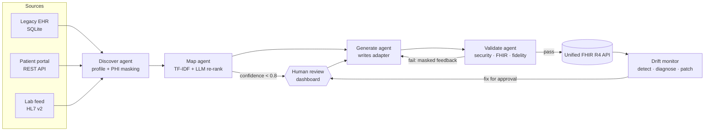

# MedRelay

**AI agents that carry hospital data into FHIR, without dropping a thing.**

*In a relay race, the baton never touches the ground. In hospitals today, patient data gets dropped between
systems all the time. MedRelay's agents carry it safely from messy legacy systems into one FHIR record.*

EXL x UCD Data & AI Hackathon 2026 · Challenge 01: Agentic healthcare integration

MedRelay is a pipeline of AI agents that discovers messy healthcare systems, maps their fields to
HL7 FHIR R4, writes and tests the integration code, publishes one unified FHIR API, and repairs
integrations when a source system changes. A human approves at every gate.

> All data is synthetic. No real patient data is used anywhere in this project.

## Architecture



| Agent | What it does | Key output |
|---|---|---|
| Discover | Profiles each system (schema, OpenAPI spec, HL7 segments), masks PHI, LLM explains every field | `outputs/discovery/` |
| Map | ML retrieval ranks FHIR targets, LLM re-ranks with a confidence score; < 0.80 goes to a human | `outputs/mapping/` |
| Generate | Writes a pure Python adapter `to_fhir(entity, record)` from the approved mappings | `generated/adapters/` |
| Validate | Security scan (AST), FHIR structure check, fidelity vs truth on every record; failures go back to Generate (max 3 attempts) | `outputs/validation/` |
| Drift monitor | Detects schema changes, pairs renamed fields, patches the adapter, re-validates, waits for approval | `outputs/drift/` |

## Quick start

```bash
python -m venv .venv && source .venv/bin/activate      
python -m pip install -r requirements.txt
cp .env.example .env                                   

python scripts/build_all.py                             
python scripts/smoke_test.py                            
```

Three terminals:

```bash
# 1 - mock patient portal (source system)
python -m uvicorn mock_systems.rest_api.app:app --port 8001

# 2 - run the whole pipeline
python run_pipeline.py

# 3 - dashboard (and optionally the FHIR API on :8002)
python -m streamlit run dashboard/app.py
python -m uvicorn fhir_api.app:app --port 8002          
```

Individual steps: `python -m agents.discover`, `python -m agents.map`, `python scripts/evaluate_mapping.py`,
`python -m agents.validate`, `python -m agents.drift`.

Drift demo: `python scripts/simulate_drift.py --apply` → `python -m agents.drift` →
`python -m agents.drift --approve` → `python scripts/simulate_drift.py --reset`.

Speed: the three systems run in parallel, identical Gemini questions are answered from a local cache
(`outputs/.llm_cache`, failed code is never cached), and every call is timed - see `python scripts/llm_timing.py`.
Start from a later step with `python run_pipeline.py --from validate`. Delete `outputs/.llm_cache` or set
`LLM_CACHE=0` for completely fresh answers.

Hard mode (no schema comments for the agents to read): `python scripts/build_all.py --hard`.

## Deploy

Free hosting on **Streamlit Community Cloud**: the dashboard rebuilds the data and starts the internal APIs
itself on first load. A `Dockerfile` is included for Docker hosts such as Render. See
[docs/deploy.md](docs/deploy.md). Set `DEMO_MODE=1` and `ADMIN_PASSWORD` so visitors can browse
results and try the drift demo without spending your Gemini quota.

## The three mock systems

| System | Tech | What makes it hard | Patient ID |
|---|---|---|---|
| Legacy EHR | SQLite | Cryptic names (`PT_DOB_DT`), `YYYYMMDD` dates, sex codes 1/2/9, code lookup table, UPPERCASE text | MRN `400001` |
| Patient portal | REST / FastAPI | Nested abbreviated JSON, `DD/MM/YYYY` dates, API key, pagination | `MBR-007919` (+ `extRef` = MRN) |
| Lab feed | HL7 v2.5.1 files | Pipe-delimited segments, `\r` terminators, components, LOINC codes | PID-3 = MRN |

The same patient appears in all three under different IDs and formats. MedRelay links them via the MRN.

## How we measure success

| Metric | Where |
|---|---|
| Mapping accuracy vs answer key (ML baseline vs MedRelay) | `outputs/mapping/evaluation.md` |
| Auto-approved precision and number sent to human review | `outputs/mapping/evaluation.md` |
| Data fidelity: % of field values reproduced exactly in FHIR | `outputs/validation/*.json` |
| Attempts needed (self-healing) and agent time per system | `outputs/pipeline_summary.json` |
| PHI values masked before any LLM call | `outputs/discovery/privacy.json` |
| Drift: time to detect + fix | `outputs/drift/latest.json` |

## Project layout

Note: code folders keep the working name `fhirbridge` (e.g. `fhirbridge_runtime/`, `urn:fhirbridge:mrn`).

```
agents/              discover, map, generate, validate, drift, checks, privacy, llm, fhir_catalog
fhirbridge_runtime/  connectors (read sources), transforms (tested helpers), env
fhir_api/            unified FHIR R4 API + merged store
dashboard/           Streamlit human-in-the-loop dashboard + assistant
mock_systems/        legacy DB, REST API, HL7 feed builders
data/                synthetic truth data generator
ground_truth/        mapping answer key
tests/               reference adapters (hand-written, used only to test the checks)
scripts/             build, smoke test, evaluation, drift simulation
docs/                Responsible AI note, demo script
run_pipeline.py      one command for the whole pipeline
```

## Responsible AI

See [docs/responsible_ai.md](docs/responsible_ai.md). In short: synthetic data only; at most 3 masked
sample values per field reach the LLM; generated code is statically checked (no I/O, logging or secrets);
four human approval gates; every attempt is logged.

## AI tools used

- **Claude (Anthropic)**: helped design and scaffold the codebase.
- **Google Gemini**: runtime LLM used by the agents (switchable to Azure OpenAI or Ollama via `.env`).
